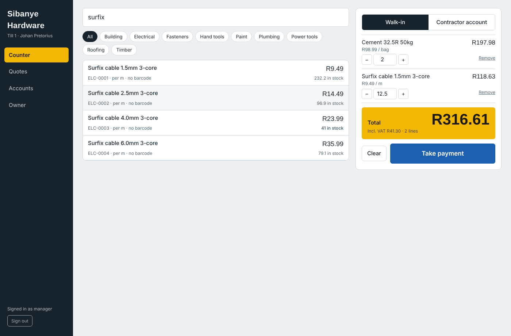
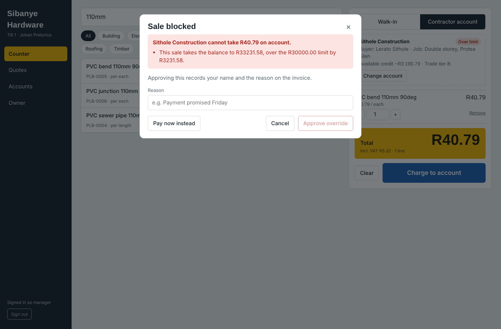
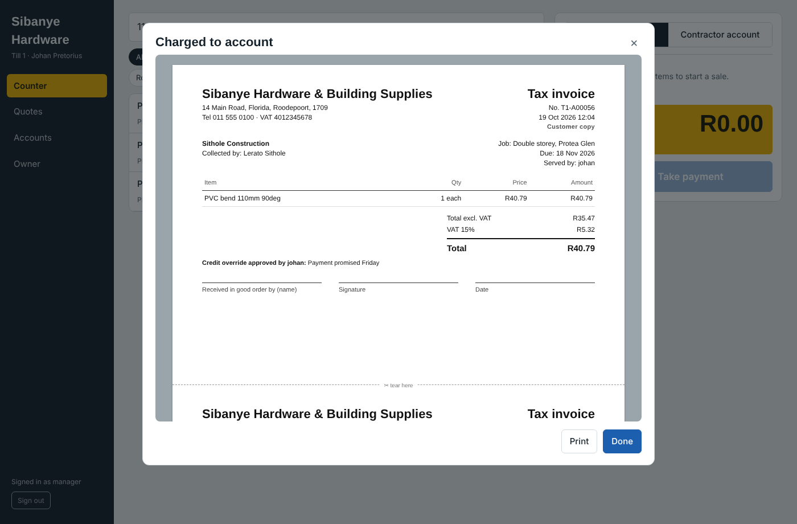
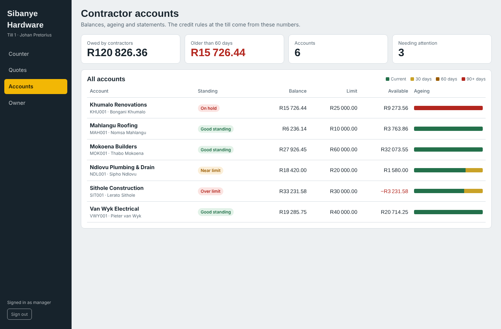
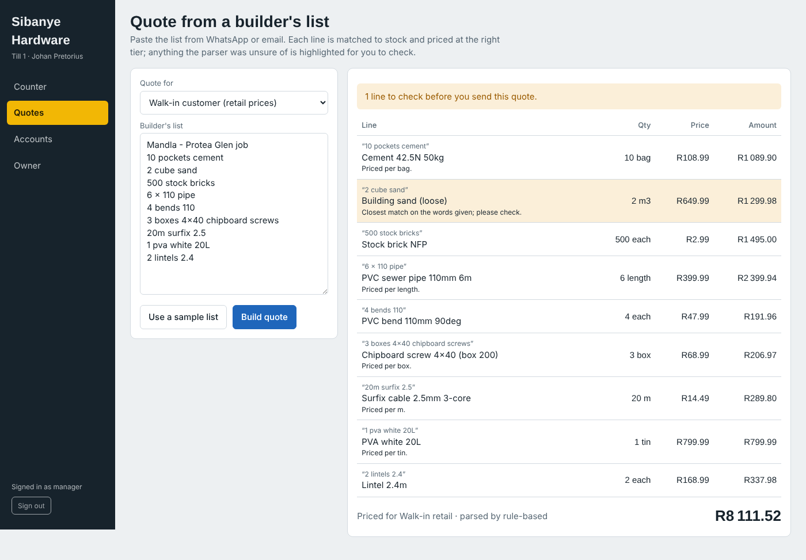
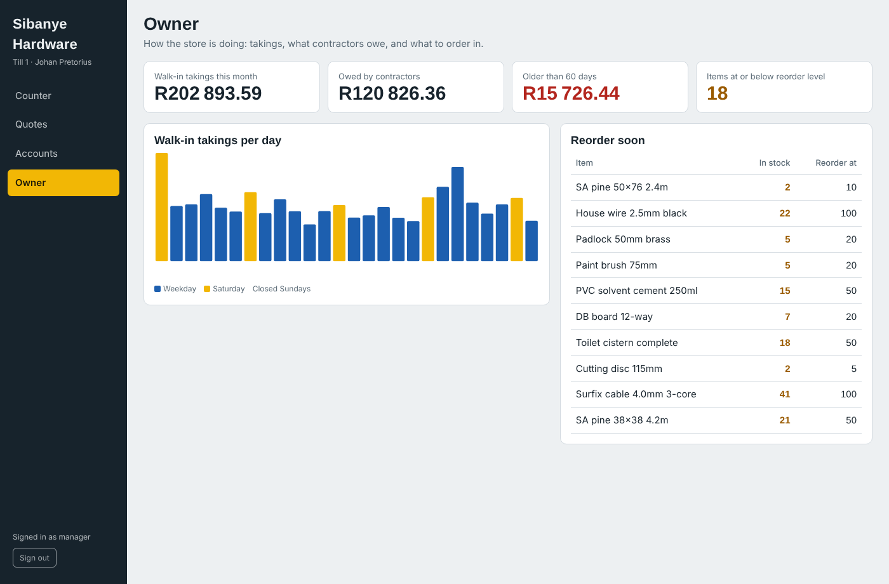

# Hardware POS

A point-of-sale system for a small hardware store, built around the two ways such a store
actually sells: cash over the counter, and credit to the builders who keep it in business.

Off-the-shelf POS software handles the first well and the second barely at all. A hardware
store carries thousands of lines with no barcodes, sells cable by the metre and sand by the
cubic metre, and runs informal credit accounts for contractors whose foremen and drivers
collect on their behalf. That second half is usually a paper book behind the counter.

**Stack:** Java 21, Spring Boot 3.5, PostgreSQL 16, Flyway, Angular 20, Docker.
**Tests:** 72 — 53 unit, 19 integration against a real PostgreSQL.



---

## Run it

```bash
git clone https://github.com/TheeNtsakoSibisi/hardware-pos.git
cd hardware-pos
docker compose up --build
```

Then open <http://localhost:4200> and sign in:

| Username | Password   | Role    | Can do                                      |
|----------|------------|---------|---------------------------------------------|
| `thandi` | `demo1234` | Cashier | Sell, charge to accounts, quote             |
| `johan`  | `demo1234` | Manager | The above, plus credit overrides and payments |
| `owner`  | `demo1234` | Owner   | Everything, plus the dashboard              |

The database arrives seeded with a fictional store: 223 products, six contractor accounts
and three months of trading. Every account is set up to put one rule under load — Sithole
Construction is over its limit, Khumalo Renovations is 90 days overdue and on hold,
Mokoena Builders is in good standing.

Buyer PINs for the demo accounts are listed in [docs/demo-data.md](docs/demo-data.md).

---

## What it does

### Walk-in sales

The common case, and the one that has to be fast. Search by name, SKU or barcode; sell by
the metre, kilogram or cubic metre as well as by the unit; take cash, card or EFT, with
change calculated. A customer who needs a tax invoice in their business name gets one
without a separate workflow.

Receipts print two to an A4 sheet, because the store already owns an office printer and the
same paper has to serve for quotes, invoices and statements.

### Contractor accounts

This is the part that is missing from the cheap alternatives.

An account carries a credit limit, payment terms and a trade price tier. It also carries
**authorised buyers**: the owner, the site foreman, the driver, each with their own PIN and
optionally their own per-sale ceiling. Every sale is tagged to a **job site**, so the builder
can bill their own client per site, and the invoice names the person who actually collected.



Four rules decide whether a sale may go on account: the account is on hold, something on it
is more than 90 days old, the sale would cross the credit limit, or the collector is over
their own limit. All four are checked at once so the cashier explains the problem once
rather than three times.

A refusal is not the end. A manager can approve the sale, and the reason is printed on the
invoice and kept against the account, so the owner can see later what was waved through.



### Statements and ageing



Payments are allocated oldest invoice first, because contractors pay round amounts against
a statement rather than invoice by invoice. Ageing is derived from those allocations rather
than from a running balance column, so the buckets on the statement always reconcile with
the invoices behind them. An overpayment sits unallocated on the account instead of being
forced onto an invoice that does not exist yet.

### Quotes from a builder's list

Builders send materials lists by WhatsApp, written the way builders write: *"10 pockets
cement, 2 cube sand, 6 x 110 pipe, 3 boxes 4x40 chipboard screws"*. Pricing that by hand at
the counter takes twenty minutes while a queue forms.



The parser sits behind an interface with two implementations:

- **Rule-based** (default): local trade vocabulary, weighted word overlap, sizes compared as
  numbers so `110` reaches `110mm` and `boxes` reaches `box 200`. No network, no API key, no
  cost. It parses the sample list above at 9 of 9 lines.
- **Claude** (optional): set `POS_AI_ANTHROPIC_API_KEY` and the Claude implementation takes
  over, handling shorthand the rules cannot. If the API is unreachable or rate limited, it
  falls back to the rule-based parser rather than failing the counter.

Either way, nothing is priced silently. Lines the parser was unsure of come back flagged,
and a person confirms before a quote reaches a customer.

### Owner view



Takings per trading day, what contractors owe, how much of it is over 60 days, and what has
fallen below its reorder level.

---

## Design decisions

Each of these was a choice with a cost, made for a reason.

**Sales are append-only.** A sale is never edited after capture; a correction is a new sale
that reverses it. This is what makes the offline queue safe to replay and the day's takings
reconstructable from the rows alone.

**Stock is a sum of movements, not a column.** Two tills selling the last bag of cement
append two movements instead of overwriting each other's count.

**Money is `BigDecimal`, scaled to two decimals, rounded half-up, everywhere.** No `double`
touches the money path. VAT is derived out of the inclusive total rather than added to a net
figure, so the printed total always equals what the customer paid.

**Offline-first, because the power goes out.** The till holds queued sales in local storage
and each one carries a UUID it generated itself. Re-sending the queue is therefore safe: the
server recognises a sale it already stored instead of charging twice. One bad sale in a
batch is reported back and skipped rather than blocking the rest.

**Document numbers are per till** (`T1-000123`, `T2-000123`). Two tills that have been
offline all morning can both capture sales and sync without colliding.

**Time is injected.** Ageing, credit and due dates all depend on "today", and a test that
cannot move today cannot prove a 90-day rule.

**Flyway owns the schema and Hibernate validates against it.** The mapping and the
migrations cannot drift apart without the application refusing to start — which is exactly
how a column-type mismatch was caught during development rather than in production.

---

## Architecture

```
Angular 20 (standalone components, signals)
   │  session cookie, /api proxied by nginx
   ▼
Spring Boot 3.5 ── Spring Security (cashier / manager / owner)
   │
   ├── sales       Sale aggregate, pricing, document numbering, offline sync
   ├── accounts    credit rules, ageing, statements
   ├── payments    oldest-first allocation
   ├── catalogue   products, stock movements
   └── ai          quote parser: rule-based by default, Claude when configured
   │
   ▼
PostgreSQL 16, schema owned by Flyway
```

Layout:

```
backend/     Spring Boot API, Flyway migrations, 72 tests
frontend/    Angular till application
data/        the demo dataset and the generator that produces the seed migration
docs/        screenshots, demo data reference, domain rules
```

---

## Development

Database only, then run each side with live reload:

```bash
docker compose up -d db

cd backend  && mvn spring-boot:run     # http://localhost:8080
cd frontend && npm start               # http://localhost:4200, proxies /api
```

Tests:

```bash
cd backend
mvn test      # 53 unit tests, no database needed
mvn verify    # adds 19 integration tests against PostgreSQL
```

The integration tests run against a real database rather than an in-memory stand-in,
because the things most worth testing here — the Flyway migrations, `NUMERIC` arithmetic,
`FOR UPDATE` row locking on the number sequence — are exactly the things H2 would fake.

CI runs the same commands on every push, plus a job that regenerates the seed migration and
fails if the committed file differs, so the seed cannot be edited by hand without notice.

### The demo dataset

`data/seed_generator.py` turns the CSVs in `data/` into
`backend/src/main/resources/db/migration/V2__demo_seed.sql`. Two details worth knowing:

- Every date is written relative to `CURRENT_DATE`, so the account that is meant to be 90
  days overdue still is, whenever you run the migration.
- The generator is deterministic: running it twice produces a byte-identical migration.

No real customer, pricing or contractor data appears anywhere in this repository. The store,
the contractors and the staff are invented.

---

## What is deliberately not here

Honest scope, since a demo that claims everything proves nothing:

- **Payment-terminal integration.** The cashier runs the card machine and captures the
  approval code. Integrating a terminal is a provider-specific project of its own, and the
  store can work from day one without it.
- **Goods receiving and purchase orders.** Stock movements support them; the screens do not
  exist yet.
- **Returns and refunds.** The append-only model is built for them; the counter flow is not
  written.
- **Multi-store.** Everything assumes one store with several tills.
- **CSRF tokens.** The API is called by the till with a session cookie inside the shop
  network and serves no HTML forms. Exposing it more widely would mean turning CSRF
  protection on and moving to OIDC.

---

## Licence

MIT. See [LICENSE](LICENSE).

Built by [Ntsako Sibisi](https://github.com/TheeNtsakoSibisi) — Full Stack Java Engineer,
Limpopo, South Africa.
